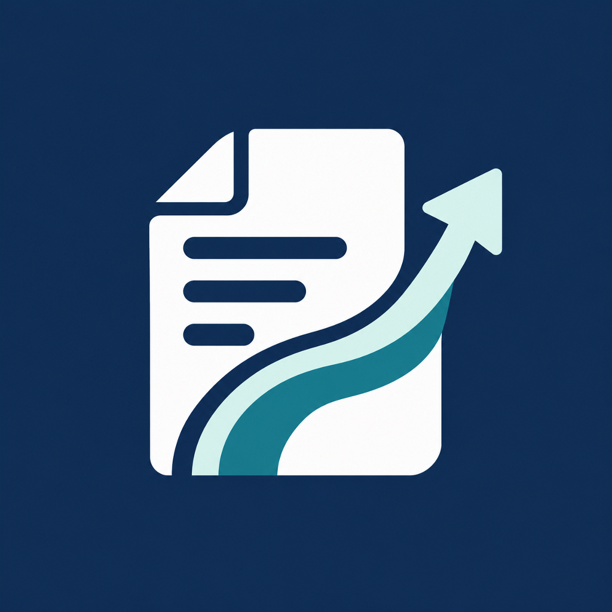

<a href="https://covernote-cac.vercel.app/"></a>

# CoverNote

**Understand insurance letters. Keep daily health records. Prepare for the doctor’s visit.**

[See the app and demos](https://covernote-cac.vercel.app/) · [Download the Android demo APK](https://github.com/Matthew-JuHyuk/CoverNote/releases/download/covernote-demo-1.0.18/CoverNote-1.0.18-android.apk)

CoverNote is an Android student project for the Congressional App Challenge by **Ju-hyuk Won and Carter Monllor**. It helps families organize information for their care team, especially when English is not their first language.

## What the app does

- **Understand a letter:** photograph or upload an insurance document, review extracted requests and dates against the original, and see what to gather.
- **Keep daily records:** speak or type symptoms and medicine use, review before saving, or confirm a registered medicine with a quick tap.
- **Add local context:** associate available environmental information with the date of a record, distinguishing observations, forecasts, and missing data.
- **Prepare an English summary:** organize records for the care team and identify missing supporting documents before a request or after a denial.

The demonstration follows fictional Diego and his mother María, who is more comfortable in Spanish. The website includes actual app recordings using synthetic demo data.

## Background and design

Ju-hyuk’s exploratory AlphaFold and protein-binding research prompted a practical question: how can a family explain that treatment does not seem to be helping? Computational research inspired the project; it does not establish an individual’s medication response. A physician at Dr. Chung’s Medical Office provided feedback on the report’s content and organization. This was design feedback, not clinical certification.

The team designed and tested the user journey, simplified navigation, reviewed translations, and refined the reporting format. AI assists with letter extraction, note organization, and translation; users review results. CoverNote does not diagnose, select treatment, or guarantee insurance approval.

## Try the final demo

[GitHub Release download](https://github.com/Matthew-JuHyuk/CoverNote/releases/download/covernote-demo-1.0.18/CoverNote-1.0.18-android.apk) · [Website download mirror](https://covernote-cac.vercel.app/downloads/covernote-android.apk)

The [Android APK](https://covernote-cac.vercel.app/downloads/covernote-android.apk) is the same build offered on the public website: **1.0.18 (18)**, 74,228,721 bytes. Android may ask permission to install an app downloaded through your browser. Existing app data may remain when updating an installation.

SHA-256:
```text
cef87e582a6b6c37f434cd35921c153adb16ff26ded9c58b6d098aeecd5199c5
```

This is a demonstration build using the existing development signing configuration, not an app-store release. No shared account password is published here. iPhone support is a future goal; the presence of an iOS scaffold does not imply a released iOS app.

## Technology and source

- Flutter / Dart: application interface and workflows.
- Kotlin: Android speech integration.
- Supabase: authentication, PostgreSQL, storage, and TypeScript Edge Functions.
- Server-side AI: document extraction, note organization, and translation.

See [developer setup](docs/setup.md) for configuring your own backend and building the app, and [source map](docs/README.md) for the main directories. Server credentials must never be bundled into the client.

## License

[Apache License 2.0](LICENSE).
